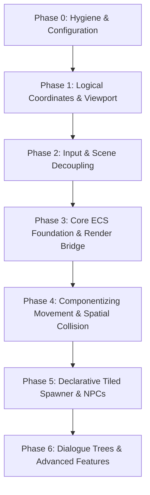

# 🎮 Game Engine Architecture Refactor & ECS Roadmap

This document outlines the phased migration plan to transition the `elementals` game engine from the current monolithic prototype architecture into a **declarative, component-based Entity Component System (ECS)**.

---

## 🎯 Architecture Goals

1. **Declarative Entity Definition**: Define characters, items, triggers, and NPCs via composable data templates/prefabs rather than sprawling class hierarchies.
2. **Decoupled Simulation & Rendering**: Game logic, positions, and collisions run strictly in a fixed logical coordinate space ($1\text{ tile} = 32\text{px}$). Screen resizing and pixel scaling are handled entirely by camera viewport/zoom.
3. **Multi-Entity Scalability**: NPCs, followers, wild creatures, and interactable objects share the exact same movement, animation, and collision components as the Player.
4. **Tiled Map Auto-Hydration**: Tiled object layers (`type`, `prefab`, `properties`) automatically instantiate declarative game entities with zero boilerplate.
5. **Decoupled Scene Architecture**: UI, dialogue, and HUD components react to game state and events without holding direct references to concrete gameplay sprites.
6. **Zero Regression Guarantee**: Each phase is self-contained, tested, and delivers an immediately playable build.

---

## 🧩 The Target Declarative ECS Pattern

```
                       ┌──────────────────────┐
                       │     World (ECS)      │
                       └──────────┬───────────┘
                                  │
      ┌───────────────────────────┼───────────────────────────┐
      ▼                           ▼                           ▼
┌───────────┐               ┌───────────┐               ┌───────────┐
│  Entities │               │Components │               │  Systems  │
│(Pure IDs) │               │(Pure Data)│               │(Pure Logic│
└─────┬─────┘               └─────┬─────┘               └─────┬─────┘
      │                           │                           │
      ▼                           ▼                           ▼
  • Player                    • Transform                 • InputSystem
  • Elder NPC                 • GridMovement              • MovementSystem
  • Chest                     • FreeMovement              • SpatialCollisionSystem
  • Warp Door                 • Collider                  • RenderBridgeSystem
                              • SpriteView                • AnimationSystem
                              • Interactable              • InteractionSystem
                              • DialogueTrigger
```

### Declarative Prefab Example
Instead of writing a 300-line `ElderNPC.ts` class, entities are declared as composable data structures:

```typescript
export const ElderNpcPrefab = definePrefab({
  name: "Elder NPC",
  components: [
    Transform({ x: 12, y: 8 }),
    SpriteView({ texture: "npc-elder", depth: 20 }),
    Collider({ width: 24, height: 16, offsetY: 16 }),
    GridMovement({ speed: 100 }),
    Interactable({
      type: "on_interact",
      action: (world, entityId) => {
        world.events.emit(Events.SHOW_DIALOGUE, "The ancient stones have begun to glow...");
      }
    }),
    WanderAI({ radius: 3, interval: 4000 })
  ]
});
```

---

## 🗺️ Migration Roadmap (Phase by Phase)



---

### Phase 0: Hygiene & Foundation (Completed)
*Objective: Eliminate dead code and separate static configuration from mutable runtime state.*

- [x] **Remove Dead Code:**
  - Delete unused `src/counter.ts` (Vite template artifact).
  - Move standalone scripts (`scratch/analyze_font.py`, `scratch/generate_bmfont.py`) to a dedicated project-level `tools/` directory.
- [x] **State & Config Segregation:**
  - Split `src/config.ts` into:
    - `src/constants/game.ts`: Pure immutable configuration (`TILE_SIZE = 32`, `VIEWPORT_TILES_X = 15`, `VIEWPORT_TILES_Y = 10`, `ASPECT_RATIO = 1.5`).
    - `src/core/SettingsStore.ts`: Reactive runtime settings (`tileBasedMovement`, `debugFlags`, `keyBindings`) with subscription callbacks instead of global object mutation.

**Verification:** Game builds and runs cleanly; toggling `T` updates `SettingsStore` reactively.

---

### Phase 1: Logical Coordinates & Viewport Normalization (Completed)
*Objective: Decouple game coordinates from screen scaling so entities never need to re-scale or re-project on window resize.*

- [x] **Simulation Space Standardization:**
  - Standardize all gameplay logic (positions, velocities, collision checks) to **1x Logical Coordinates** ($1\text{ tile} = 32\text{px}$).
- [x] **Camera-Driven Integer Zoom:**
  - In `src/scenes/Game.ts`, refactor `handleResize()`:
    - Camera viewport size is locked to logical dimensions ($15 \times 32 = 480\text{px}$ by $10 \times 32 = 320\text{px}$).
    - Apply integer zoom via `this.cameras.main.setZoom(renderScale)` with letterboxing.
  - Remove all manual layer and sprite scaling:
    - Eliminate `layer.setScale(scale)` from `MapSystem`.
    - Eliminate `this.x = (this.x / oldScale) * newScale` from `Player.ts`.
    - Eliminate coordinate scaling from `CollisionSystem.ts`.

**Verification:** Resizing the browser window scales pixel art smoothly via camera zoom; player position and collision boundaries remain perfectly intact with zero coordinate recalculation.

---

### Phase 2: Decouple Input & Scene Communication (Completed)
*Objective: Stop 60 FPS EventBus flooding and eliminate direct object references across scene boundaries.*

- [x] **State-Polled Input Architecture:**
  - Refactor `InputManager`:
    - Instead of emitting `Events.INPUT_DIRECTION` over `EventBus` 60 times per second, `InputManager` maintains an internal `InputSnapshot` (`{ vector: Vector2, run: boolean, action: boolean, menu: boolean }`).
    - Expose `inputManager.getSnapshot()` for controllers to query on tick.
    - Reserve `EventBus` purely for discrete events (`Events.ACTION_PRESSED`, `Events.MENU_TOGGLED`).
- [x] **Decouple UI from Game Entities:**
  - Remove `EventBus.emit(Events.PLAYER_READY, this.player)`.
  - UI scenes (e.g. `UIScene`, `HUDManager`) must not hold a reference to `Player`.
  - When dialogue or menu opens, UI emits `Events.SET_INPUT_LOCKED, { locked: true }`.
  - Input system or movement controllers listen to the lock state, isolating UI from player sprite instances.
  - `DebugHUD` queries read-only data from a centralized `World` or `GameState` rather than inspecting private sprite properties.

**Verification:** Opening menus, dialogues, and toggling debug HUD works with complete decoupling; neither `HUDManager` nor `DebugHUD` references `Player`.

---

### Phase 3: Core ECS Foundation & Render Bridge
*Objective: Implement a lightweight, fast TypeScript ECS and a bridge that synchronizes ECS transforms with Phaser display objects.*

- [ ] **Lightweight ECS Engine (`src/ecs/`):**
  - `World`: Container managing entities, component pools, and system update loops.
  - `Entity`: Lightweight numeric ID (`number`).
  - `Component`: Simple data classes or factory functions (`TransformComponent`, `SpriteComponent`, `TagComponent`).
  - `System`: Abstract base class with `update(world: World, delta: number)`.
- [ ] **Declarative Prefab System (`src/ecs/prefabs/`):**
  - Implement `definePrefab({ name, components })` and `world.spawnPrefab(prefabName, overrides)`.
- [ ] **Phaser Render Bridge System (`RenderBridgeSystem`):**
  - Listens for entities with `TransformComponent` + `SpriteComponent`.
  - Instantiates or updates a corresponding `Phaser.GameObjects.Sprite` inside the Phaser scene.
  - Automatically updates sprite `x`, `y`, `depth`, and frame when components change.
  - Destroys Phaser sprite when the entity is removed from `World`.

**Verification:** A test entity (e.g., a stationary decoration or test sprite) is spawned declaratively through the ECS and renders on screen through Phaser.

---

### Phase 4: Componentizing Movement, Animation & Spatial Collision
*Objective: Dismantle the 355-line `Player.ts` god object into reusable ECS components and systems.*

- [ ] **Unified Spatial Collision System (`SpatialSystem`):**
  - Combines static tile collision with dynamic entity bounding boxes.
  - Stores a 2D spatial grid:
    - Tilemap solid tiles.
    - Dynamic entity colliders (`ColliderComponent`).
  - Provides `isWalkable(logicalX, logicalY, ignoreEntityId?)`.
- [ ] **Movement Components & Systems:**
  - `GridMovementComponent`: Encapsulates 32px step tweens, direction, and step progress.
  - `FreeMovementComponent`: Encapsulates velocity, acceleration, and sliding collision.
  - `MovementSystem`: Executes movement updates based on active movement component.
- [ ] **Animation System (`AnimationSystem`):**
  - Manages 4-directional walk/run/idle animation states based on entity movement velocity and direction.
- [ ] **Player Prefab Migration:**
  - Replace `Player.ts` class with a declarative `PlayerPrefab`:
    ```typescript
    components: [
      Transform({ x: spawnX, y: spawnY }),
      PlayerInput(),
      Collider({ width: 16, height: 8 }),
      GridMovement(),
      SpriteView({ texture: "player", frame: "walk" })
    ]
    ```
  - The camera simply follows the entity tagged with `PlayerTag`.

**Verification:** Player moves with identical feel in both tile-based and continuous modes; collision and sliding work identically, but the code is now 100% component-driven.

---

### Phase 5: Declarative Tiled Spawner & NPC System
*Objective: Automatically spawn interactive NPCs and world objects directly from Tiled maps.*

- [ ] **Tiled Object Spawner:**
  - Extend `MapSystem` to read Tiled object layers.
  - Map Tiled object types to registered prefabs:
    - `type: "npc"` $\rightarrow$ spawns NPC entity with dialogue, collision, and idle animation.
    - `type: "warp"` $\rightarrow$ spawns a trigger entity with destination map and coordinates.
    - `type: "sign"` $\rightarrow$ spawns an interactable examine object.
- [ ] **NPC Behaviors:**
  - Add optional `WanderAIComponent` for simple random grid wandering.
  - When the player presses the action button facing an NPC, the `InteractionSystem` triggers the NPC's interaction callback.
  - NPC turns to face the player when speaking.

**Verification:** Add an NPC object to `city.json` in Tiled; the NPC automatically spawns with proper depth, collision, idle animation, and interactive dialogue.

---

### Phase 6: Advanced ECS Capabilities
*Objective: Build scalable game features leveraging the established ECS foundation.*

- [ ] **Dialogue & Cutscene Engine:**
  - Multi-line branching dialogue with choices and speaker portraits.
  - Scripted cutscene component (moves entities along waypoints, locks player input).
- [ ] **Inventory & Items:**
  - Item drop entities in the world with pickup triggers.
  - Inventory component attached to Player.
- [ ] **Trigger Zones:**
  - Wild grass encounter zones, footsteps audio triggers, indoor/outdoor lighting zones.

---

## 📁 Proposed Target Directory Structure

```text
game/src/
├── core/
│   ├── GameState.ts               # Global game lifecycle & scene coordination
│   ├── EventBus.ts                # Strongly typed event definitions
│   └── SettingsStore.ts           # Runtime settings (movement mode, audio)
├── constants/
│   ├── game.ts                    # Immutable game constants (TILE_SIZE, VIEWPORT)
│   └── assets.ts                  # Asset keys, map manifests, sprite definitions
├── ecs/
│   ├── World.ts                   # ECS entity manager & tick coordinator
│   ├── Entity.ts                  # Entity ID definitions & queries
│   ├── components/
│   │   ├── Transform.ts           # Logical X, Y, depth
│   │   ├── SpriteView.ts          # Texture, visual offset, flip
│   │   ├── Collider.ts            # Hitbox dimensions & collision masks
│   │   ├── GridMovement.ts        # Grid step movement data
│   │   ├── FreeMovement.ts        # Continuous velocity & sliding data
│   │   ├── PlayerControlled.ts    # Input consumer flag
│   │   ├── Interactable.ts        # On-interact / On-step triggers
│   │   └── AIWander.ts            # Wandering AI parameters
│   ├── systems/
│   │   ├── InputSystem.ts         # Updates controlled entities from InputManager
│   │   ├── MovementSystem.ts      # Applies movement physics & grid stepping
│   │   ├── SpatialSystem.ts       # Unified tile & entity collision resolution
│   │   ├── RenderBridgeSystem.ts  # Syncs ECS entities with Phaser GameObjects
│   │   ├── AnimationSystem.ts     # Drives sprite animations from movement state
│   │   └── InteractionSystem.ts   # Detects action-button triggers & step zones
│   └── prefabs/
│       ├── PlayerPrefab.ts        # Player entity template
│       ├── NpcPrefab.ts           # Reusable NPC template
│       ├── WarpTriggerPrefab.ts   # Door / zone transition template
│       └── SignPrefab.ts          # Inspectable world object template
├── input/
│   ├── InputManager.ts            # Keyboard & gamepad polling
│   └── InputSnapshot.ts           # Frame-frozen input data contract
├── world/
│   ├── MapSystem.ts               # Tilemap lifecycle coordinator
│   ├── TiledObjectSpawner.ts      # Hydrates Tiled objects into ECS prefabs
│   └── tilemap/                   # Decoupled tilemap parsers (existing)
├── ui/
│   ├── HUDManager.ts              # UI root coordinator
│   ├── DialogueHUD.ts             # Dialogue box & text typing
│   ├── MapSwitcherHUD.ts          # Dev map switcher
│   └── DebugHUD.ts                # Debug stats overlay
└── scenes/
    ├── Boot.ts                    # Asset loading bootstrap
    ├── Preloader.ts               # Sprite sheets & audio loading
    ├── Game.ts                    # Main gameplay scene
    └── UIScene.ts                 # Parallel overlay UI scene
```

---

## 🚀 Execution Strategy

Each phase can be tackled as an independent sprint:
1. **Never break master:** At the end of each phase, `npm run dev` must run cleanly with the game fully playable.
2. **Side-by-side migration:** Phase 3 introduces the ECS without deleting `Player.ts`. Phase 4 migrates `Player.ts` to components. Old and new can coexist until verification passes.
3. **Commit checkpoints:** Each phase gets its own descriptive git commit and verification tests.
